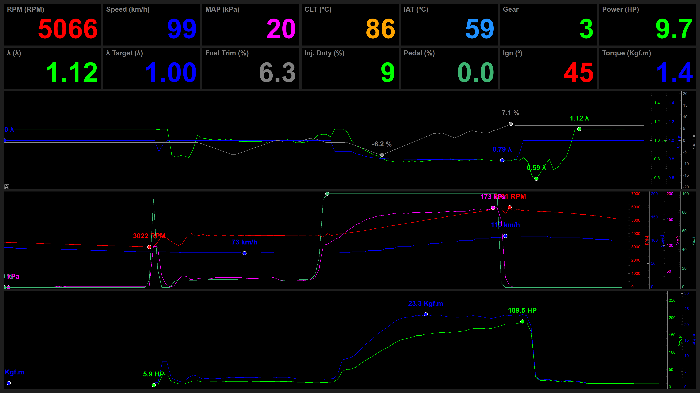

# Master Injection Dashboard

A real-time telemetry dashboard for the Master Injection ECU. Streams sensor data over Bluetooth (Windows COM port), displays live values and graphs, plays audible alarms on limit violations, and logs everything to CSV.



## Demo


---

## Features

- **Full-screen live display** — large high-contrast numeric values with automatic color coding (green = in range, red = out of limits)
- **Real-time graphs** — multi-axis buffered plots with peak/min markers, updated every 100 ms
- **Audible alarms** — plays a `.wav` file while any signal stays outside its configured limits; the alarm stays active for 2 seconds after the last out-of-range reading
- **VE map calibration** — live 16×16 VE map viewer with heatmap coloring, bilinear interpolation highlight of the current operating point, and keyboard-driven ±5 adjustments written to the ECU with a 1-second debounce
- **Lambda loop control** — open and close the lambda loop from the VE calibration screen with a keystroke; plays a configurable sound on each command
- **CSV logging** — one file per run; appends every ECU frame with a millisecond Unix timestamp and an optional event label
- **Automatic reconnection** — detects dropped Bluetooth connections and reconnects without restarting the app
- **Mock mode** — replay a previously recorded CSV file instead of connecting to hardware

---

## Requirements

- Windows (COM port + `.wav` playback)
- Python 3.9+
- Bluetooth-paired ECU device

---

## Installation

```bash
pip install -r requirements.txt
```

Dependencies: `pyserial`, `pyqt6`, `pyqtgraph`.

---

## Running

```bash

# optional
export MI_DASHBOARD_CONFIG_FILE=config.json

python main.py
```

Close the window to exit.

---

## Tests

```bash
pip install -r requirements-dev.txt
python -m pytest
```

Tests run headless (no ECU, display or audio device needed). Every feature ships with unit tests; see `CLAUDE.md` for the conventions.

---

## Configuration

Settings are loaded from `config.json` in the working directory or from the file named by the `MI_DASHBOARD_CONFIG_FILE` environment variable. If the file is absent, defaults apply.

```json
{
  "connection": {
    "port": "COM1",
    "baudrate": 115200,
    "mock": ""
  },
  "alarm": {
    "sound": "alarm.wav"
  },
  "datalog": {
    "path": "C:\\Datalogs"
  },
  "dashboard": {
    "grid": [["RPM", "VSS", "MAP", "BOOST", "CLT", "IAT", "POWER"],
             ["LAMBDA", "LAMBDA_TARGET", "FUEL_TRIM", "BOOST_TARGET", "INJ_UTIL", "IGN", "TORQUE"]],
    "graph": [["RPM", "MAP"], ["LAMBDA", "LAMBDA_TARGET", "FUEL_TRIM"]],
    "graph_x_size": 150
  },
  "ve_calibration": {
    "ve_sound": "alarm.wav",
    "closed_sound": "alarm.wav",
    "open_sound": "alarm.wav"
  }
}
```

| Key | Description |
|-----|-------------|
| `connection.port` | Windows COM port (`"COM5"`, etc.) |
| `connection.baudrate` | Serial baud rate |
| `connection.mock` | Path to a recorded CSV for playback without hardware; `""` to use real serial |
| `alarm.sound` | `.wav` file played during limit alarms |
| `datalog.path` | Existing directory where the per-run CSV logs (`log_stream_YYYYMMDD_HHMMSS.csv`) are created |
| `dashboard.grid` | 2-D list of signal names for the numeric display grid |
| `dashboard.graph` | List of row groups (each group shares one plot) |
| `dashboard.graph_x_size` | Number of samples kept in each graph buffer |
| `ve_calibration.ve_sound` | `.wav` played after VE rows are written to the ECU |
| `ve_calibration.closed_sound` / `open_sound` | `.wav` files played when the lambda loop is closed / opened |

Signal definitions (name, ECU index, unit, limits, graph color, alarm thresholds) are in `app/masterinjection/signal.py`.

---

## Screens

The app uses a full-screen stacked layout. Navigation between screens is keyboard-only. **Esc** returns to the Home screen from the Dashboard and the VE calibration screen.

### Home Screen

The entry point of the application. Displays the app title, connection status, and a navigable menu.

- Title: `Master Injection` centered at the top
- Connection status: port/baudrate (or mock file path) + a colored dot — green when connected, red when disconnected. Refreshed every 500 ms.
- Menu items: `Dashboard` and `Calibração de VE`
- Keyboard hint at the bottom

### Dashboard Screen

Full-screen live telemetry display. Shows the configured signals as numeric cards and plots them on real-time graphs.

- **Signal grid** — rows and columns configured in `dashboard.grid`. Each cell shows the signal name, current value, and unit.
- **Graphs** — one plot per group in `dashboard.graph`. Each plot can show multiple signals on independent Y-axes (right-side), with a shared X-axis. Peak and minimum markers with value labels float over each curve. Graphs refresh every 100 ms.

### VE Calibration Screen

Live VE (Volumetric Efficiency) map viewer and editor. Allows real-time adjustment of the ECU's 16×16 fuel map while the engine is running, with visual feedback of the current operating point.

- **Top bar** — live values for RPM, MAP, VE, Lambda, Lambda Target, Fuel Trim, and Lambda Loop state.
- **VE Map table (left)** — 16×16 grid. Rows are MAP (kPa) values (high at top, low at bottom); columns are RPM values. Cells are colored with a heatmap; the cells around the current operating point are highlighted in orange, weighted by bilinear interpolation. Modified cells are shown in cyan text.
- **VE Graph (right)** — one curve per MAP row. Overlaid points mark all map nodes; the active interpolation region is highlighted. A lime dot marks the current VE reading from the ECU; a cyan dot marks the predicted `VE_LAMBDA` value (visible only in closed loop).
- Edits are written to the ECU one second after the last key press. Resetting the map restores the ECU values and writes them back.

---

## Keyboard shortcuts

| Key | Screen | Action |
|-----|--------|--------|
| **Esc** | Dashboard, VE Calibration | Return to Home screen |
| **↑ / ↓** | Home | Navigate menu |
| **Enter** | Home | Open selected screen |
| **↑ / ↓** | VE Calibration | Adjust VE ±5 raw units (0.5 %) at the current operating point |
| **O** | VE Calibration | Send `LAMBDA_LOOP_OPEN` to the ECU + play sound |
| **P** | VE Calibration | Send `LAMBDA_LOOP_CLOSE` to the ECU + play sound |
| **R** | VE Calibration | Reset all VE cells to the ECU values |

---

## Specifications

The behavior of the system is specified with [OpenSpec](https://github.com/Fission-AI/OpenSpec) in `openspec/specs/` (one folder per capability: ECU connection and protocol, signals, alarms, dashboard, VE calibration, datalog, ...). Those specs are the reference for protocol details, signal tables, the CSV format and the ECU field positions. Planned and in-flight work lives in `openspec/changes/`.
