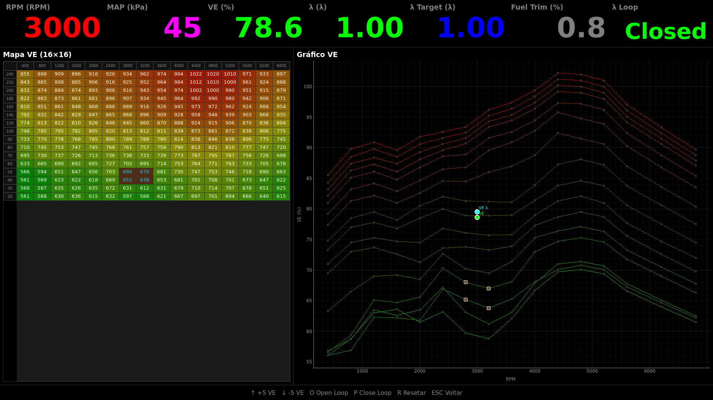

# Master Injection Dashboard

A real-time telemetry dashboard for the Master Injection ECU. Streams sensor data over Bluetooth (Windows COM port), displays live values and graphs, plays audible alarms on limit violations, and logs everything to CSV.


## Demo


---

## Features

- **Full-screen live display** — large high-contrast numeric values with automatic color coding (green = in range, red = out of limits)
- **Real-time graphs** — multi-axis buffered plots with peak/min markers, updated every 100 ms
- **Audible and visual alarms** — plays a `.wav` file while any signal with an enabled alarm stays outside its limits, and the signal's card on the Dashboard flashes black/yellow; the alarm stays active for 2 seconds after the last out-of-range reading
- **VE map calibration** — live 16×16 VE map viewer with heatmap coloring, bilinear interpolation highlight of the current operating point, and keyboard-driven ±5 adjustments written to the ECU with a 1-second debounce
- **Lambda loop control** — open and close the lambda loop from the VE calibration screen with a keystroke; plays a configurable sound on each command
- **CSV logging** — one file per run; appends every ECU frame with a millisecond Unix timestamp and an optional event label
- **Ignition tuning** — on-road search for the best spark advance at light load: one global advance offset (±1° per key press) applied to the ignition rows up to a MAP limit, with one column per offset comparing injection time, MAP and pedal at the same RPM and gear
- **Manual event marking** — press **Enter** on the Dashboard, the VE calibration screen or the ignition tuning screen to beep and stamp `MARK` on the next CSV row
- **Automatic reconnection** — detects dropped Bluetooth connections and reconnects without restarting the app, retrying once per second
- **Connection error alerts** — a square, dialog-like overlay shows the failure (port, error detail) for 2 seconds on whatever screen is active, without taking the keyboard; the same error is not repeated while it persists
- **Mock mode** — replay a previously recorded CSV file instead of connecting to hardware

### VE map calibration

Live 16×16 VE map with heatmap coloring and the bilinear-interpolation highlight of the current operating point (orange). Cells edited with **↑ / ↓** show in cyan text and are written to the ECU one second after the last key press; the graph plots one curve per MAP row, with the live VE (lime) and the lambda-corrected VE λ (cyan, closed loop only).



### Ignition tuning

Built for the road: hold a steady RPM in a fixed gear, raise the advance 1° at a time with **↑** and read, column by column, what the engine needed to keep the same speed. Each column is one advance offset, showing the analysed time, mean ignition, mean injection time, MAP, pedal, lambda and the knock counter increase, with the percentage difference to the best value of each sensor. The column with the lowest mean injection time gets the green border and the blue header marks the offset currently applied. **Space** pauses (hill ahead), **X** discards the worst column, **R** restores the original map. Sounds confirm each write, pause, discard and a column that gathered enough time, so the driver does not need to look at the screen.


*Ignition tuning screenshot with illustrative data (six offsets, 0° to +5°, best result at +4°), not a real tuning session.*

---

## Requirements

- Windows (COM port + `.wav` playback)
- Python 3.9+
- Bluetooth-paired ECU device

---

## Installation

```bash
pip install -r requirements.txt
```

Dependencies: `pyserial`, `pyqt6`, `pyqtgraph`.

---

## Running

```bash

# optional
export MI_DASHBOARD_CONFIG_FILE=config.json

python main.py
```

Close the window to exit.

---

## Tests

```bash
pip install -r requirements-dev.txt
python -m pytest
```

Tests run headless (no ECU, display or audio device needed). Every feature ships with unit tests; see `CLAUDE.md` for the conventions.

---

## Configuration

Settings are loaded from `config.json` in the working directory or from the file named by the `MI_DASHBOARD_CONFIG_FILE` environment variable. If the file is absent, defaults apply.

```json
{
  "connection": {
    "port": "COM1",
    "baudrate": 115200,
    "mock": "",
    "mock_skip_lines": 0
  },
  "alarm": {
    "sound": "alarm.wav"
  },
  "datalog": {
    "path": "C:\\Datalogs",
    "mark_sound": "alarm.wav"
  },
  "dashboard": {
    "grid": [["RPM", "VSS", "MAP", "BOOST", "CLT", "IAT", "POWER"],
             ["LAMBDA", "LAMBDA_TARGET", "FUEL_TRIM", "BOOST_TARGET", "INJ_UTIL", "IGN", "TORQUE"]],
    "graph": [["RPM", "MAP"], ["LAMBDA", "LAMBDA_TARGET", "FUEL_TRIM"]],
    "graph_x_size": 150
  },
  "ve_calibration": {
    "ve_sound": "alarm.wav",
    "closed_sound": "alarm.wav",
    "open_sound": "alarm.wav"
  },
  "ignition_tuning": {
    "rpm_min": 2900,
    "rpm_max": 3100,
    "gear": 5,
    "max_map_kpa": 70
  }
}
```

| Key | Description |
|-----|-------------|
| `connection.port` | Windows COM port (`"COM5"`, etc.) |
| `connection.baudrate` | Serial baud rate |
| `connection.mock` | Path to a recorded CSV for playback without hardware; `""` to use real serial |
| `connection.mock_skip_lines` | Number of data lines (after the header) the mock skips the first time it plays the file, to start in an interesting region; default `0` |
| `alarm.sound` | `.wav` file played during limit alarms |
| `datalog.path` | Existing directory where the per-run CSV logs (`log_stream_YYYYMMDD_HHMMSS.csv`) are created |
| `datalog.mark_sound` | `.wav` played when you mark an event with Enter; default `alarm.wav` |
| `dashboard.grid` | 2-D list of signal names for the numeric display grid |
| `dashboard.graph` | List of row groups (each group shares one plot) |
| `dashboard.graph_x_size` | Number of samples kept in each graph buffer |
| `ve_calibration.ve_sound` | `.wav` played after VE rows are written to the ECU |
| `ve_calibration.closed_sound` / `open_sound` | `.wav` files played when the lambda loop is closed / opened |
| `ignition_tuning.rpm_min` / `rpm_max` | RPM band (inclusive) analysed on the ignition tuning screen; default `2900` / `3100` |
| `ignition_tuning.gear` | Gear in which samples are analysed; default `5` |
| `ignition_tuning.max_map_kpa` | Highest MAP axis value (kPa) of the ignition rows the offset changes; rows above stay untouched; default `70` |
| `ignition_tuning.max_ignition` | Highest raw ignition value (degrees) a cell can reach; default `50` |
| `ignition_tuning.settle_seconds` | Seconds ignored after a write, a resume or the lambda loop closing again; default `5` |
| `ignition_tuning.min_scenario_seconds` | Analysed seconds a scenario needs before it is compared; default `20` |
| `ignition_tuning.write_sound` / `ready_sound` / `pause_sound` / `resume_sound` / `discard_sound` | `.wav` cues: ignition rows written, scenario has enough time, analysis paused / resumed, worst scenario discarded |

Signal definitions (name, ECU index, unit, limits, graph color, alarm thresholds) are in `app/masterinjection/signal.py`.

---

## Screens

The app uses a full-screen stacked layout. Navigation between screens is keyboard-only. **Esc** returns to the Home screen from the Dashboard, the VE calibration screen and the ignition tuning screen.

### Home Screen

The entry point of the application. Displays the app title, connection status, and a navigable menu.

- Title: `Master Injection` centered at the top
- Connection status: port/baudrate (or mock file path) + a colored dot — green when connected, red when disconnected. Refreshed every 500 ms.
- Menu items: `Dashboard`, `Calibração de VE` and `Ajuste de Ignição`
- Keyboard hint at the bottom

### Dashboard Screen

Full-screen live telemetry display. Shows the configured signals as numeric cards and plots them on real-time graphs.

- **Signal grid** — rows and columns configured in `dashboard.grid`. Each cell shows the signal name, current value, and unit. A value outside its limits turns red; if the signal has an alarm enabled, its card also flashes while the alarm is active.
- **Graphs** — one plot per group in `dashboard.graph`. Each plot can show multiple signals on independent Y-axes (right-side), with a shared X-axis. Peak and minimum markers with value labels float over each curve. Graphs refresh every 100 ms.

### VE Calibration Screen

Live VE (Volumetric Efficiency) map viewer and editor. Allows real-time adjustment of the ECU's 16×16 fuel map while the engine is running, with visual feedback of the current operating point.

- **Top bar** — live values for RPM, MAP, VE, Lambda, Lambda Target, Fuel Trim, and Lambda Loop state.
- **VE Map table (left)** — 16×16 grid. Rows are MAP (kPa) values (high at top, low at bottom); columns are RPM values. Cells are colored with a heatmap; the cells around the current operating point are highlighted in orange, weighted by bilinear interpolation. Modified cells are shown in cyan text.
- **VE Graph (right)** — one curve per MAP row. Overlaid points mark all map nodes; the active interpolation region is highlighted. A lime dot marks the current VE reading from the ECU; a cyan dot marks the predicted `VE_LAMBDA` value (visible only in closed loop).
- Edits are written to the ECU one second after the last key press. Resetting the map restores the ECU values and writes them back.

### Ignition Tuning Screen

Built to be used while driving, with almost no looking: the driver holds a steady RPM in a fixed gear on a flat road, raises the advance one degree at a time and the screen shows what the engine needed to keep the same speed.

- **Offset** — ↑ / ↓ move one global advance offset by ±1°. It is applied to every column of the ignition rows (`#I01`..`#I16`) whose MAP axis value is at or below `ignition_tuning.max_map_kpa`; higher rows are never touched. The written map is always `original + offset` (clamped to 0..`max_ignition`), so cells clamped at 0 return to their original value when the offset comes back up. Writes go to ECU RAM only: a power cycle restores the stored map.
- **Columns** — one per offset tried, in ascending order: RPM band, analysed time, mean ignition, mean injection time, mean MAP, mean pedal, mean lambda and the knock counter increase. For injection time, MAP and pedal the percentage difference to the best value of that sensor is shown; the column with the lowest mean injection time (among columns with enough analysed time, at least two) gets a green border.
- **What is analysed** — only frames with RPM inside the band, the configured gear, the lambda loop closed (1 or 2), not paused and past the settle time. **Space** pauses and resumes (for a hill ahead). **X** discards the worst column (highest mean injection time among the comparable ones) to clean up the comparison; it never discards the column of the current offset and does not touch the ECU map.
- **Cues** — configurable sounds confirm a write, a pause / resume, a discard and a column that gathered enough time.

---

## Keyboard shortcuts

| Key | Screen | Action |
|-----|--------|--------|
| **Esc** | Home | Exit the app |
| **Esc** | Dashboard, VE Calibration, Ignition Tuning | Return to Home screen |
| **Enter** | Dashboard, VE Calibration, Ignition Tuning | Beep + stamp `MARK` on the next CSV row |
| **↑ / ↓** | Home | Navigate menu |
| **Enter** | Home | Open selected screen |
| **↑ / ↓** | VE Calibration | Adjust VE ±5 raw units (0.5 %) at the current operating point |
| **O** | VE Calibration | Send `LAMBDA_LOOP_OPEN` to the ECU + play sound |
| **P** | VE Calibration | Send `LAMBDA_LOOP_CLOSE` to the ECU + play sound |
| **R** | VE Calibration | Reset all VE cells to the ECU values |
| **↑ / ↓** | Ignition Tuning | Raise / lower the advance offset by 1° (held keys act once) |
| **Space** | Ignition Tuning | Pause / resume the analysis |
| **X** | Ignition Tuning | Discard the worst scenario (not the current one); changes no map value |
| **R** | Ignition Tuning | Offset back to 0, original ignition map written back, analysis cleared |

---

## Specifications

The behavior of the system is specified with [OpenSpec](https://github.com/Fission-AI/OpenSpec) in `openspec/specs/` (one folder per capability: ECU connection and protocol, signals, alarms, dashboard, VE calibration, datalog, ...). Those specs are the reference for protocol details, signal tables, the CSV format and the ECU field positions. Planned and in-flight work lives in `openspec/changes/`.
