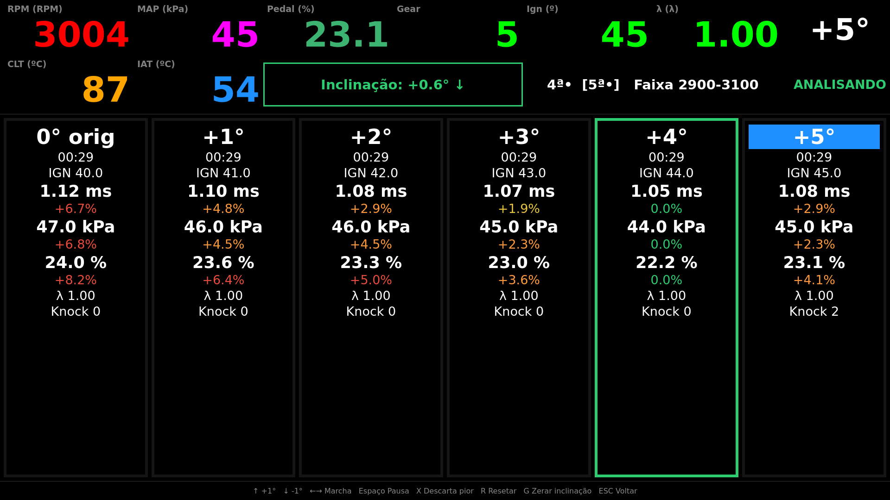

# Master Injection Dashboard: Python app

The desktop dashboard for the Master Injection ECU: live telemetry, graphs, alarms, CSV logging, VE map calibration and on-road ignition tuning. For what the system is and what it can do, see the [main README](../README.md); this page has the details of the Python app.

The optional inclinometer is a separate device, described in the [Inclinometer README](../inclinometer/README.md).

**Run every command on this page from the `dashboard/` folder** (`cd dashboard`): `config.json`, the `resources/` sounds and `pytest.ini` are found from there.

---

## Requirements

- Windows (COM port + `.wav` playback)
- Python 3.9+
- Bluetooth-paired ECU device

---

## Installation

```bash
cd dashboard
pip install -r requirements.txt
```

Dependencies: `pyserial`, `pyqt6`, `pyqtgraph`.

---

## Running

```bash
cd dashboard

# optional
export MI_DASHBOARD_CONFIG_FILE=config.json

python main.py
```

Close the window to exit.

---

## Tests

```bash
cd dashboard
pip install -r requirements-dev.txt
python -m pytest
```

Tests run headless (no ECU, display or audio device needed). Every feature ships with unit tests; see [`CLAUDE.md`](../CLAUDE.md) for the conventions.

---

## Configuration

Settings are loaded from `config.json` in the working directory (`dashboard/config.json`) or from the file named by the `MI_DASHBOARD_CONFIG_FILE` environment variable. If the file is absent, defaults apply.

```json
{
  "connection": {
    "port": "COM1",
    "baudrate": 115200,
    "mock": "",
    "mock_skip_lines": 0
  },
  "alarm": {
    "sound": "alarm.wav"
  },
  "datalog": {
    "path": "C:\\Datalogs",
    "mark_sound": "alarm.wav"
  },
  "dashboard": {
    "grid": [["RPM", "VSS", "MAP", "BOOST", "CLT", "IAT", "POWER"],
             ["LAMBDA", "LAMBDA_TARGET", "FUEL_TRIM", "BOOST_TARGET", "INJ_UTIL", "IGN", "TORQUE"]],
    "graph": [["RPM", "MAP"], ["LAMBDA", "LAMBDA_TARGET", "FUEL_TRIM"]],
    "graph_x_size": 150
  },
  "ve_calibration": {
    "ve_sound": "alarm.wav",
    "closed_sound": "alarm.wav",
    "open_sound": "alarm.wav"
  },
  "ignition_tuning": {
    "rpm_min": 2900,
    "rpm_max": 3100,
    "gears": [4, 5],
    "max_map_kpa": 70,
    "max_tilt_deg": 3
  },
  "gyro": {
    "port": "COM7"
  }
}
```

Sound and file paths in it (for example `resources/alarm.wav`) are relative to the working directory, so keep running the app from `dashboard/`.

The Settings screen (**F12**) saves changes to this same file: it re-reads the file, changes only the edited key and writes the whole file back indented. Every setting is meant to be editable there; the ones that are not yet (paths, sounds, lists) are still edited by hand.

| Key | Description |
|-----|-------------|
| `connection.port` | Windows COM port (`"COM5"`, etc.) |
| `connection.baudrate` | Serial baud rate |
| `connection.mock` | Path to a recorded CSV for playback without hardware; `""` to use real serial |
| `connection.mock_skip_lines` | Number of data lines (after the header) the mock skips the first time it plays the file, to start in an interesting region; default `0` |
| `alarm.sound` | `.wav` file played during limit alarms |
| `datalog.path` | Existing directory where the per-run CSV logs (`log_stream_YYYYMMDD_HHMMSS.csv`) are created |
| `datalog.mark_sound` | `.wav` played when you mark an event with Enter; default `alarm.wav` |
| `dashboard.grid` | 2-D list of signal names for the numeric display grid |
| `dashboard.graph` | List of row groups (each group shares one plot) |
| `dashboard.graph_x_size` | Number of samples kept in each graph buffer |
| `ve_calibration.ve_sound` | `.wav` played after VE rows are written to the ECU |
| `ve_calibration.closed_sound` / `open_sound` | `.wav` files played when the lambda loop is closed / opened |
| `ignition_tuning.rpm_min` / `rpm_max` | RPM band (inclusive) analysed on the ignition tuning screen; default `2900` / `3100` |
| `ignition_tuning.gears` | List of gears in which samples are analysed, each with its own columns; default `[5]` |
| `ignition_tuning.max_map_kpa` | Highest MAP axis value (kPa) of the ignition rows the offset changes; rows above stay untouched; default `70` |
| `ignition_tuning.max_ignition` | Highest raw ignition value (degrees) a cell can reach; default `50` |
| `ignition_tuning.settle_seconds` | Seconds ignored after a write, a resume or the lambda loop closing again; default `5` |
| `ignition_tuning.min_scenario_seconds` | Analysed seconds a scenario needs before it is compared; default `20` |
| `ignition_tuning.max_tilt_deg` | Highest absolute pitch (degrees) at which the ignition analysis samples, when the inclinometer is configured; default `3` |
| `gyro.port` | COM port of the inclinometer; `""` (default) means there is none. When set, the inclinometer is **required** by the ignition analysis. The link is fixed at 115200 baud |
| `ignition_tuning.write_sound` / `ready_sound` / `pause_sound` / `resume_sound` / `discard_sound` | `.wav` cues: ignition rows written, scenario has enough time, analysis paused / resumed, worst scenario discarded |

Signal definitions (name, ECU index, unit, limits, graph color, alarm thresholds) are in `app/masterinjection/signal.py`.

---

## Features in detail

### VE map calibration

Correct the ECU's 16×16 VE (volumetric efficiency) map **while driving**. The cursor on the map is the car itself: drive into the condition you want to fix (the RPM and MAP of the region), notice a large error between what the map says and what the engine needs, and adjust that region by hand on the spot. It is meant for regions that are very far off.

1. Open **Calibração de VE** (or press **F2**) with the engine running. The map has a **cursor** that you do not move with the keyboard: it is the ECU's current operating point, placed from the live RPM and MAP, and the cells around it are tinted orange. To put the cursor on a region, drive the car into that RPM and MAP.
2. With the cursor on the region, look for a large error: the cyan dot (VE λ) far from the lime dot (VE), or a lambda far from its target, in the top bar.
3. Press **↑ / ↓** to raise or lower VE by 5 raw units (0.5 %) where the cursor is. Hold the key to repeat. Edited cells show in cyan text.
4. Stop pressing. One second after the last edit the app writes the changed rows to the ECU and plays a confirmation sound.
5. Press **P** / **O** to close / open the lambda loop (the cyan VE λ dot is only shown with the loop closed).
6. Press **R** to throw the edits away and write the ECU's original values back.

**How to read it:**

- **Table** — rows are MAP, columns are RPM; the heatmap goes from green (low VE) to dark red (high VE).
- **Cursor** — the orange cells on the table and the dots on the graph: they follow the ECU's live RPM and MAP, so the cursor is the car and moves as you drive. Edits always apply where it is.
- **Graph** — one curve per MAP row, with two dots at the cursor:
  - **lime dot — VE:** the VE the ECU is using right now.
  - **cyan dot — VE λ:** a value the app calculates from the measured lambda, the fuel trim and the lambda target (`(LAMBDA + FUEL_TRIM − LAMBDA_TARGET) × VE / 10000`). It equals the lime dot when lambda is on target with no trim, and moves away from it as the closed loop corrects; shown only with the loop closed.
- **Top bar** — RPM, MAP, VE, lambda, lambda target, fuel trim and the lambda loop state.


### Ignition tuning

Built for the road: hold a steady RPM in a fixed gear and read, column by column, what the engine needed to keep the same speed.

1. Hold a steady RPM inside the band (`ignition_tuning.rpm_min` – `rpm_max`) in a configured gear, on level ground, with the lambda loop closed.
2. Raise the advance 1° with **↑**. The app writes the new map, waits for it to settle and starts a new column.
3. Repeat, watching the columns fill up.
4. Note the best offset (green border) and press **R** to restore the original map when done.

**What a column shows** (one column = one advance offset):

- analysed time (`mm:ss`) and mean ignition
- mean injection time, mean MAP and mean pedal, each with the percentage difference to the best value of that sensor
- mean lambda and the knock counter increase

**How to read it:**

- the **green border** marks the column with the lowest mean injection time (needs at least two columns with enough analysed time)
- the **blue header** marks the offset currently applied
- **Space** pauses (hill ahead), **X** discards the worst column, **R** restores the original map (see [Keyboard shortcuts](#keyboard-shortcuts))

**Also:**

- **Several gears** can be analysed in the same session (`ignition_tuning.gears`, for example `[4, 5]`). The screen shows one gear at a time, follows the engaged gear, and **←** / **→** look at the other one. Comparisons are always made inside a gear.
- **Sounds** confirm each write, pause, discard and a column that gathered enough time, so the driver does not need to look at the screen.



*Ignition tuning screenshot with illustrative data (two gears, six offsets from 0° to +5°, best result at +4°, inclinometer zeroed at +0.6°), not a real tuning session. Top bar, first line: RPM, MAP, pedal, gear, ignition and lambda, with the offset and the status on the right. Second line: coolant and intake temperature, the inclination box, the gear indicator and the analysed RPM band.*

### Inclinometer (optional)

A slope changes the load the engine needs, so samples taken uphill or downhill are not comparable with samples taken on the flat. An optional inclinometer (an Arduino with an MPU-6500, serial 115200 8N1, 100 Hz) tells the ignition tuning screen when the car is not level.

**Setting it up**

1. Set `gyro.port` (for example `"COM7"`) in `config.json`, or pick the port on the Settings screen (**F12**). `Nenhuma` turns the inclinometer off.
2. The app connects by itself and retries every 2 seconds while the port is missing. This never touches the ECU connection and never shows the error overlay.
3. On a flat stretch, zero it: **G** on the ignition tuning screen, or **Zerar inclinação** on the Settings screen.

**The zero is always manual**

- The app sends `#Z` and trusts the device's answer (`#M;Zero definido;`). It never zeroes by itself, and the device keeps the zero.
- The inclination is **not used** until you zero it again after: the app starts, the device restarts or reconnects (opening the port restarts many Arduino boards), or a gyroscope recalibration.
- **Recalibrar giroscópio** (`#C`) is only sent with the car stopped.

**When the ignition analysis may sample** (only when `gyro.port` is set; with no port nothing changes):

- the inclinometer is connected and sending, not calibrating, and zeroed
- `|pitch|` is within `ignition_tuning.max_tilt_deg` (default `3`°)
- after the car is level again, samples are discarded for `ignition_tuning.settle_seconds`, so the stretch of road that tilted the car never enters a column

**The inclination box** (second line of the ignition tuning top bar, next to the temperatures). Positive pitch = nose down (`↓`), negative = nose up (`↑`):

| Box | Colour | Meaning | Analysis status |
|-----|--------|---------|-----------------|
| `Inclinação: +1.4° ↓` | green | usable, within the limit | `ANALISANDO` |
| `Inclinação: +4.5° ↓` | red | usable, above the limit | `INCLINADO` |
| `Inclinação: sem zero (G)` | orange | connected, not zeroed | `AGUARDANDO SENSOR` |
| `Inclinação: sem sinal` | orange | no data for more than 1 s | `AGUARDANDO SENSOR` |
| `Inclinação: calibrando…` | orange | the device is recalibrating | `AGUARDANDO SENSOR` |
| `Inclinação: desconectada` | orange | port configured but not open | `AGUARDANDO SENSOR` |
| `Inclinação: desligada` | gray | no `gyro.port` | not used |

**The device and its protocol** (serial lines `#D`, `#H`, `#M`, commands `#Z`, `#C`) are described in the [Inclinometer README](../inclinometer/README.md).

---

## Screens

The app uses a full-screen stacked layout. Navigation between screens is keyboard-only. **Esc** returns to the Home screen from the Dashboard, the VE calibration screen, the ignition tuning screen, the ECU screen and the Settings screen. **F1** to **F4** and **F12** open the Dashboard, VE calibration, Ignition tuning, ECU and Settings from any screen.

### Home Screen

The entry point of the application. Displays the app title, connection status, and a navigable menu.

- Title: `Master Injection` centered at the top
- Connection status: port/baudrate (or mock file path) + a colored dot — green when connected, red when disconnected. Refreshed every 500 ms.
- Menu items: `Dashboard`, `Calibração de VE`, `Ajuste de Ignição`, `ECU` and `Configurações`
- Keyboard hint at the bottom

### ECU Screen

List of ECU settings changed from the keyboard. For now it has one field:

- **Fase** — `Negativa` or `Positiva` (`—` while the ECU value is unknown).
  - **Enter** toggles it; the field shows the requested value followed by `…` while the change is in progress.
  - One second after the last change the app requests `#X02`, replaces only the phase value (position 11, `0` = Negativa, `1` = Positiva), writes the block back (playing the VE confirmation sound `ve_calibration.ve_sound`) and reads it again to confirm.
  - The write-on-memory command (`#D04`) is **not** sent, so the phase returns to the stored one when the ECU is power-cycled.
- **Status line** — `Alteração pendente…`, `Enviando para a ECU…`, `Fase aplicada (não gravada na memória)` or the failure (`Sem resposta da ECU`, `Resposta #X02 inválida`, `A ECU manteve a fase …`).
- Enter here does not stamp a `MARK` in the CSV log.

### Settings Screen

Opened with **F12** (or from the Home menu). Edits `config.json` from the keyboard: **↑ / ↓** select a row, **← / →** change a value, **Enter** runs an action. Every change is saved at once and the status line reads `Salvo` (or `Não foi possível gravar a configuração`).

| Row | Keys | What it does |
|-----|------|--------------|
| **Porta** | ← / → | `Nenhuma` or one of the serial ports of the machine (`gyro.port`) |
| **Conectar** / **Desconectar** | Enter | opens or closes the inclinometer port |
| **Zerar inclinação** | Enter | sends `#Z`: the device takes the current position as level |
| **Recalibrar giroscópio** | Enter | sends `#C`; refused while the car is moving |
| **Inclinação máxima** | ← / → | `ignition_tuning.max_tilt_deg`, 0.5° steps |
| **RPM mínimo** / **RPM máximo** | ← / → | the analysed band, 100 rpm steps. Changing it discards the scenarios of the current run (its results file is closed first, with the old band) |
| **Estabilização** | ← / → | `ignition_tuning.settle_seconds`, 1 s steps |
| **Tempo mínimo do cenário** | ← / → | `ignition_tuning.min_scenario_seconds`, 5 s steps |

Under the gyroscope rows the screen shows the inclinometer state (`Conectado, zerado`, `Conectado, sem zero`, `Sem sinal`, ...), pitch, roll, temperature and the latest message of the device. How the zero works is described in [Inclinometer](#inclinometer-optional).

### Dashboard Screen

Full-screen live telemetry display. Shows the configured signals as numeric cards and plots them on real-time graphs.

- **Signal grid** — rows and columns configured in `dashboard.grid`. Each cell shows the signal name, current value, and unit. A value outside its limits turns red; if the signal has an alarm enabled, its card also flashes while the alarm is active.
- **Graphs** — one plot per group in `dashboard.graph`. Each plot can show multiple signals on independent Y-axes (right-side), with a shared X-axis. Peak and minimum markers with value labels float over each curve. Graphs refresh every 100 ms.

### VE Calibration Screen

Live viewer and editor of the ECU's 16×16 fuel map while the engine is running, with visual feedback of the current operating point. The screen refreshes every 100 ms.

- **Top bar** — seven cards: RPM, MAP, VE, Lambda, Lambda Target, Fuel Trim and Lambda Loop. The loop card is green when the loop is closed (`Closed`, `Closed+C`) and orange when it is open.
- **VE map table (left)** — 16×16 grid of raw values.
  - Columns are RPM (ascending to the right); rows are MAP in kPa (highest at the top).
  - The heatmap goes from green (lowest) through yellow to dark red (highest).
  - The cells around the current operating point are tinted orange, weighted by bilinear interpolation. This is the table's **cursor**: it is not moved with the keyboard, it follows the ECU's live RPM and MAP.
  - Modified cells (different from the value the ECU confirmed) show in cyan text.
- **VE graph (right)** — RPM against VE %.
  - One thin curve per MAP row, from green (lowest MAP) to red (highest).
  - A small square marks every map node; the interpolated ones are larger and orange.
  - The dots sit at the live RPM: a **lime dot** for the live VE reported by the ECU and a **cyan dot** for `VE λ`, calculated by the app from lambda, fuel trim and lambda target (visible only with the loop closed).
- **Editing** — **↑ / ↓** change VE by ±5 raw units (0.5 %) at the current operating point and do nothing until RPM and MAP have been received. Holding the key repeats the edit.
- **Writing to the ECU**
  - One second after the last edit, every changed row is written in full (16 values), in ascending row order. Rows that were not edited are not sent, and an edit undone within the delay sends nothing.
  - The write-on-memory command is **not** sent: the changes live in ECU RAM until a power cycle.
  - A sound (`ve_calibration.ve_sound`) confirms each write.
  - **R** resets the map to the values the ECU confirmed and writes all 16 rows back.
- **Lambda loop** — **O** opens it (`#D06`, plays `open_sound`) and **P** closes it (`#D05`, plays `closed_sound`). The keys only work on this screen, and the card changes only when the ECU reports the new state.

### Ignition Tuning Screen

Built to be used while driving, with almost no looking: the driver holds a steady RPM in a fixed gear on a flat road, raises the advance one degree at a time and the screen shows what the engine needed to keep the same speed. (The optional [inclinometer](#inclinometer-optional) enforces the "flat".)

- **Offset** — **↑ / ↓** move one global advance offset by ±1°.
  - It is applied to every column of the ignition rows (`#I01`..`#I16`) whose MAP axis value is at or below `ignition_tuning.max_map_kpa`; higher rows are never touched.
  - The written map is always `original + offset` (clamped to 0..`max_ignition`), so cells clamped at 0 return to their original value when the offset comes back up.
  - Writes go to ECU RAM only: a power cycle restores the stored map.
- **Inclination box** — in the top bar, next to the temperatures; see [Inclinometer](#inclinometer-optional) for its states. **G** zeroes the inclinometer and changes nothing else.
- **Top bar** — two lines: RPM, MAP, pedal, gear, ignition and lambda; below them CLT, IAT, the gear indicator (`4ª•  [5ª•]`: the shown gear in brackets, a dot when a gear holds data) and the analysed RPM band.
- **Gears** — one configured gear is shown at a time.
  - It follows the engaged gear whenever it changes to a configured one; **←** / **→** switch to the other configured gear (to review it while stopped) until the next gear change.
  - Sampling always goes to the engaged gear, whatever is shown; the percentage differences and the best column are computed inside each gear.
- **Columns** — one per offset tried in the shown gear, in ascending order.
  - Each shows the analysed time, mean ignition, mean injection time, mean MAP, mean pedal, mean lambda and the knock counter increase.
  - For injection time, MAP and pedal it also shows the percentage difference to the best value of that sensor.
  - The column with the lowest mean injection time (among columns with enough analysed time, at least two) gets a green border.
- **What is analysed** — a telemetry set counts only when all of these hold:
  - RPM is inside the band and the gear is one of the configured gears
  - the lambda loop is closed (1 or 2), the analysis is not paused and the settle time has passed
  - with `gyro.port` set: the inclinometer is zeroed and sending, and `|pitch|` is within `ignition_tuning.max_tilt_deg`
- **Status** (top right, first one that applies):

  | Status | Meaning |
  |--------|---------|
  | `PAUSADO` | paused with **Space** |
  | `AGUARDANDO ECU` | the ignition map has not been received yet |
  | `AGUARDANDO SENSOR` | `gyro.port` is set but the inclinometer is not usable (not zeroed, no signal, calibrating, disconnected) |
  | `INCLINADO` | the slope is above `max_tilt_deg` |
  | `ESTABILIZANDO` | samples are discarded after a write, a resume, the lambda loop closing again or the car becoming level again (`settle_seconds`) |
  | `FORA DA FAIXA` | RPM, gear or lambda loop outside the conditions |
  | `ANALISANDO` | sampling |

- **Pause and discard** — **Space** pauses and resumes (for a hill ahead). **X** discards the worst column of the shown gear (highest mean injection time among the comparable ones) to clean up the comparison; it never discards the column of the current offset and does not touch the ECU map.
- **Cues** — configurable sounds confirm a write, a pause / resume, a discard and a column that gathered enough time.
- **Results file** — every analysis run is saved as `ignition_results_YYYYMMDD_HHMMSS.csv` in `datalog.path`.
  - One row per gear and offset: statistics, percentage differences, best, and `Discarded = 1` for the scenarios dropped with **X**.
  - It is rewritten at most every 5 seconds while results change, and when leaving the screen, on reset and when the app closes.
  - **R** closes the file; the next valid sample starts a new one.

---

## Keyboard shortcuts

| Key | Screen | Action |
|-----|--------|--------|
| **Esc** | Home | Exit the app |
| **Esc** | Dashboard, VE Calibration, Ignition Tuning | Return to Home screen |
| **Enter** | Dashboard, VE Calibration, Ignition Tuning | Beep + stamp `MARK` on the next CSV row |
| **↑ / ↓** | Home | Navigate menu |
| **Enter** | Home | Open selected screen |
| **F1** / **F2** / **F3** / **F4** / **F12** | Any screen | Open the Dashboard / VE Calibration / Ignition Tuning / ECU / Settings screen |
| **Esc** | ECU, Settings | Return to Home screen |
| **↑ / ↓** | Settings | Select a row |
| **← / →** | Settings | Change the selected value (port, limits, RPM band, times) |
| **Enter** | Settings | Connect / disconnect, zero the inclination or recalibrate the gyroscope |
| **Enter** | ECU | Toggle the phase (Negativa ↔ Positiva), written to the ECU 1 s after the last change, not saved to memory |
| **↑ / ↓** | VE Calibration | Adjust VE ±5 raw units (0.5 %) at the current operating point (held keys repeat) |
| **O** | VE Calibration | Send `LAMBDA_LOOP_OPEN` to the ECU + play sound |
| **P** | VE Calibration | Send `LAMBDA_LOOP_CLOSE` to the ECU + play sound |
| **R** | VE Calibration | Reset all VE cells to the ECU values |
| **↑ / ↓** | Ignition Tuning | Raise / lower the advance offset by 1° (held keys act once) |
| **← / →** | Ignition Tuning | Show the previous / next configured gear (until the engaged gear changes) |
| **Space** | Ignition Tuning | Pause / resume the analysis |
| **X** | Ignition Tuning | Discard the worst scenario of the shown gear (not the current one); changes no map value |
| **G** | Ignition Tuning | Zero the inclinometer (`#Z`): the current position becomes level |
| **R** | Ignition Tuning | Offset back to 0, original ignition map written back, every gear cleared, results file closed |

---

## Specifications

The behavior of the system is specified with [OpenSpec](https://github.com/Fission-AI/OpenSpec) in [`openspec/specs/`](../openspec/specs/) (one folder per capability: ECU connection and protocol, signals, alarms, dashboard, VE calibration, datalog, ...). Those specs are the reference for protocol details, signal tables, the CSV format and the ECU field positions. Planned and in-flight work lives in [`openspec/changes/`](../openspec/changes/).
